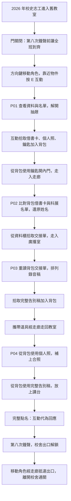

# 不存在的第八節課

版本：小安初稿 v0.2｜2026-10-29
狀態：主題與「可見角色、上下左右移動、跨場景探索、物品互動、背包及道具通關」已由使用者指定。2026-10-30 已依本稿完成第一版實作與自動化通關，仍待團隊審閱與真人初次試玩；啟動與測試方式見 README.md。
負責：小安（故事、使用者故事、解謎流程、內容資料與劇情測試）。

## 1. 一句話故事

你在舊校舍整理校史，放學後卻困在不斷響起點名廣播的教室。要離開，你必須在「第八次鐘聲」到來時，讓一位被畢業紀錄漏掉的同學重新成為班級的一員。

## 2. 體驗目標與範圍

- 類型：2D 角色移動探索、跨場景互動、背包收集與道具解謎。畫面中持續可見玩家角色；每個場景是一張可行走的地圖。
- 調性：微懸疑、懷舊、帶溫暖收尾；初稿不使用血腥、追逐或突然驚嚇。
- 玩家：沒有密室經驗也能透過文字、觀察與提示推進的人。
- 建議遊玩長度：15–20 分鐘，屬於設計目標，須實際試玩確認。
- 首版範圍：3 個場景、3 道主要謎題與 1 個收尾互動、單一完整結局。
- 所有解答的依據都放在遊戲內，不需要網路搜尋、校史知識或聽力辨識。
- 鐘聲是敘事進度，不是真實倒數；停下來閱讀、輸入錯誤或切換場景都不會讓玩家輸掉。
- 首版採固定答案，不做隨機密碼、多周目、分歧結局或即時多人。
- 最終作品須能以純前端 HTML、CSS、JavaScript 靜態展示；本稿不替小星決定套件或技術架構。

### 核心遊玩循環

移動角色探索場景 → 靠近物品互動 → 閱讀線索與提示 → 解開謎題 → 拾取道具加入背包 → 在正確物件上使用道具 → 開啟通路並返回舊場景 → 利用蒐集的道具完成最後機關 → 走出校舍通關。

### 角色移動與場景切換

- 畫面顯示玩家角色，以及角色所在場景的門、道路、家具與可互動物件。
- 以鍵盤 `↑`、`↓`、`←`、`→` 控制角色上下左右移動；角色需要實際走到物件或通道附近才能互動或切換場景。
- 角色不能穿過牆壁、封閉的門或家具；可行走區域和可互動位置須讓玩家辨識。
- 走到已開啟的門口／通道即可進入相連場景；切換後出現在對應入口內側，能正常走回原場景。
- 尚未解鎖的門顯示阻擋原因，例如「需要走廊資料區鑰匙」，不直接跳場景或扣除道具。
- 初稿操作約定：`E` 與附近物件互動、`B` 開關背包、`Esc` 關閉說明或選單。具體按鍵提示由小星呈現在畫面上。
- 閱讀文件、輸入答案或操作背包時暫停角色移動；關閉視窗後恢復，避免輸入文字同時使角色走動。

### 場景物品與提示互動

- 每個場景都有可互動物件；角色靠近時顯示物件名稱及互動提示，避免逐像素亂找。
- 互動分為「查看線索」「操作機關」「拾取道具」「使用背包道具」；不是每個物件都能拿走。
- 查看黑板、名單、借書卡、科展資料或錄音稿時，可讀取解謎所需提示；必要資訊以文字呈現，讀過後可再查看。
- 對抽屜、資料櫃或播放設備互動時，顯示該物件的解謎介面及當前狀態。
- 解開謎題只讓抽屜／資料櫃打開或道具可取得；玩家仍須互動拾取，不因知道答案就自動擁有所有道具。
- 使用錯誤道具或在條件不足時互動，顯示有意義的回饋，保留道具與已完成進度。

### 背包系統與道具規則

- 玩家可開啟背包，查看已取得道具的名稱、圖示、說明及可重讀的文件內容。
- 場景中可收集的道具，需經拾取才加入背包；同一件唯一道具只取得一次，已拾取處改為空置或已拿取狀態。
- 背包容量至少容納本作全部必要道具；首版不設重量、丟棄或道具損壞，避免玩家失去通關機會。
- 使用方式：角色走到目標附近 → 打開背包選擇道具 → 對目標使用；遠處不能直接使用道具。
- 換場景與返回舊場景會保留背包與已解鎖狀態。跨刷新存檔與重新開始的行為，由小星另訂機關驗收。
- 鑰匙成功使用後標記已使用，通道保持開啟；文件仍可重讀。照片與告別稿放置後改為「已放置」，不能重複生成，也不因再次互動被拿走而破壞進度。
- 最終必須實際蒐集並使用「個人照」和「完整告別稿」，不能只答對姓名、跳過探索或直接按通關。

| 道具 ID | 道具 | 取得位置與條件 | 背包／使用用途 |
| --- | --- | --- | --- |
| I01 | 17 號借書卡 | S01，P01 開啟抽屜後互動拾取 | 隨時重讀姓名殘字，與走廊科展名單比對 |
| I02 | 個人照 | S01，P01 開啟抽屜後互動拾取 | 保留至結尾，對教室合照空白處使用 |
| I03 | 走廊資料區鑰匙 | S01，P01 開啟抽屜後互動拾取 | 對教室通往走廊的內門使用，開放 S02 |
| I04 | 轉學交接單 | S02，P02 完成後從資料櫃互動取出 | 隨時重讀事件順序，支援 S03 的錄音稿排序 |
| I05 | 完整告別稿 | S03，P03 完成後從播放設備旁拾取 | 讀取最後線索；結尾放到 S01 講台稿架，配合個人照完成點名 |

## 3. 人物與設定

### 2026-10-31 校園支線擴充

依使用者要求新增三位可對話的校史整理同行者：S01 管理員周伯、S02 回校整理資料的許學長、S03 廣播社志工小禾。他們皆為當晚參與整理的現實人物，不把轉學學生改寫成幽靈。每人有三個可選話題，並依尚未還原姓名、已還原姓名、最後點名完成三階段改變開場對話。

支線補充校園日常、校友記憶與錄音整理，不直接提供主線完整答案，不要求先對話才能通關。另新增九個可查看的校園觀察點：籃球、保溫瓶、粉筆字條、雨傘、失物招領單、長椅塗鴉、午休卡帶、舊延長線、校慶節目紙箱。部分物品有看似可疑的數字或標記，查看後可辨識其日常用途；不加入必要背包、觸發鐘聲或改動主線解答。筆記可保存，舊存檔可繼續讀取。內容與位置集中在 game/campus.mjs。

| 人物 | 身分與作用 |
| --- | --- |
| 玩家 | 2026 年協助整理舊校舍的校史志工；並非必須失憶或認識當年的學生。 |
| 林予安 | 1998 年三年二班 17 號，畢業前轉學。她留下個人照及告別廣播稿，希望被放進班級紀念冊。 |
| 陳老師 | 當年的導師；以舊點名錄音出現，停留在沒有收到回應的 17 號。 |

學校、班級與人物均為虛構。故事不把轉學等同死亡，也不暗示轉學生應被排除在班級之外。

### 作者知道的真相

班上原有 34 人，林予安在畢業前轉學，最後的畢業名冊只有 33 人。她留給同學的個人照與告別稿沒有被放進紀念冊，校史整理時又只抄錄畢業名冊，於是她在這份「班級記憶」中缺席。

舊校舍這一晚重現的是未完成的班級記憶，不是世界上所有關於她的資料都被消除。因此借書卡、轉學資料及個人照仍可以作為證據。

玩家最初以為必須讓 34 個人實際回到教室，後來理解「到齊」是讓每位同學都被記錄與承認。林予安仍是當年的一員，不必撤銷轉學或召回她本人。

## 4. 故事節拍

### 開場：有一節不在課表上的課

玩家進入舊教室取回校史資料，門在身後合上。走廊重複出現「三年二班」門牌。

黑板寫著：「請在第八次鐘聲，讓全班到齊。」

舊廣播響起：「三年二班，開始點名……十六號……」錄音在下一個名字前停住。班級合照有一個明顯留下的空白位置。

第一階段只提出異常與目標，不直接告知林予安的姓名或轉學真相。

### 第一幕：少掉的座號

班級資料寫著原有 34 人，現存名單卻只有 33 筆。名單按座號排列，16 與 18 之間沒有 17。

玩家移動到「待歸還物品抽屜」前互動，輸入缺少的兩位數座號。抽屜打開後，玩家逐一拾取 17 號借書卡、個人照及走廊資料區鑰匙，三件道具加入背包。再走到教室內門，從背包使用鑰匙開門，進入走廊。

獲得的新理解：缺席的是一個有座號的人，合照空白不是普通污損。

### 第二幕：把名字拼回來

玩家在走廊移動至科展資料前互動閱讀，並打開背包重讀借書卡。借書卡的姓名欄留下「林□安」，科展名單則留下「□予□」，兩者都明確標示三年二班 17 號。玩家交叉比對，還原姓名「林予安」。

姓名補回紀念名冊後，走廊的廣播室資料櫃開放；玩家靠近取出轉學交接單並加入背包，通往廣播室的通路也開放。單上說明她已在畢業前轉出，並提到先還書、再交告別廣播稿、最後辦轉學離校的順序。

獲得的新理解：她不是幽靈，也不是失蹤案件；她曾主動留下想被記得的話。

### 第三幕：最後一天並沒有告別

玩家由走廊進入廣播室，靠近播放設備互動。設備留有三段標籤清楚但順序散落的錄音稿：「還書」「廣播」「轉學」。玩家從背包查看交接單、還原順序，再播放完整文字與錄音，並互動拾取設備旁的完整告別稿，加入背包。

告別稿：「我會去新的學校，但請不要把我的位置擦掉。如果合照來不及，這張照片可以替我留下來嗎？」

獲得的新理解：真正沒有完成的是告別與紀念，不是把學生帶回教室。

### 結尾：最後一聲「到」

玩家帶著背包中的道具，從廣播室經走廊走回教室。先靠近合照，選擇個人照並對空白處使用；再走到講台，將完整告別稿放上稿架。兩件道具都正確放置後，最後點名才完整唸出「十七號，林予安」。

玩家以「代為回應點名」完成最後互動，畫面顯示：「到。轉學，也是我們班的一員。」

第八次鐘聲響起，校舍回到 2026 年，走廊的校舍出口解鎖。玩家仍需控制角色走出教室、穿過走廊並抵達出口，才進入通關畫面。校史紀念頁保留 34 位曾經在班上的同學，並註記林予安畢業前轉學；不把它冒充當年的正式畢業證書或畢業名冊。

最後文字：「離開教室的人，不該因此被擦掉。」

## 5. 場景與探索範圍

| ID | 場景 | 主要互動 | 敘事用途 |
| --- | --- | --- | --- |
| S01 | 舊教室 | 可行走地面、黑板、33 人名單、班級資料、抽屜、合照、講台稿架、廣播設備、走廊內門 | 建立異常、拾取前三件道具、開始與結束點名 |
| S02 | 走廊資料區 | 可行走通道、科展名單、紀念名冊、廣播室資料櫃、教室入口、廣播室入口、校舍出口 | 還原姓名、拾取交接單、連接場景與最終出口 |
| S03 | 廣播室 | 可行走地面、三段錄音稿、播放設備、告別稿拾取點、走廊入口 | 重讀背包交接單、還原告別、取得最後道具 |

S01 起始可探索；P01 完成、拾取 I03 並對教室內門使用後，角色可經門口走入 S02；P02 完成後可由 S02 走入 S03。已開放的內部通路可往返，背包與進度保持；校舍出口是另一扇門，只有最終點名完成才解鎖，不能用走廊鑰匙提前逃出。具體介面、移動範圍、互動距離及狀態實作由小星補入 VERIFY 的機關段。

## 6. 謎題設計表（含作者解答）

### P01：缺席的座號

- 前置：開始遊戲，控制角色走近資料與抽屜。
- 證據：E01「班級原有 34 人」；E02 列出 1–34 的座號，唯獨沒有 17，合計 33 筆。
- 題面：「待歸還物品：請輸入缺少的兩位數座號。」
- 答案：`17`；UI 可用兩格數字輸入。前後空白處理交由小星確定，不接受其他座號。
- 結果：抽屜打開，I01 借書卡、I02 個人照與 I03 走廊資料區鑰匙可分別互動拾取並加入背包；使用 I03 開啟內門後，才可走入 S02。
- 故事收穫：找到被漏掉的學生位置。
- 錯誤回饋：「抽屜沒有打開。請再比較班級人數與座號。」不清空進度；空白、格式錯誤的提示由小星補充。
- 提示 1：「全班原本的人數，和留下的名單不一樣。」
- 提示 2：「先確認名單是否按照座號連續排列。」
- 提示 3：「看看十六號與十八號之間，原本應該還有哪一筆。」

### P02：有座號，沒有名字

- 前置：P01 完成、I03 已開啟內門，角色走入 S02；已拾取 I01，能從背包重讀。
- 證據：E03 借書卡「三年二班／17 號／林□安」；E04 科展名單「三年二班／17 號／□予□」。
- 題面：「請為紀念名冊中的十七號補回姓名。」
- 答案：`林予安`。
- 推理：用相同班級與座號確認兩份資料指向同一人；姓名三個位置各有足夠字元，不能只憑猜測補字。
- 結果：名冊顯示姓名；走廊資料櫃開啟，可互動拾取 I04 轉學交接單加入背包，開放通往 S03 的通路。
- 故事收穫：學生有完整身分，她是轉學而非死亡或失蹤。
- 錯誤回饋：「請確認兩份資料上的班級與座號，再比對姓名。」
- 提示 1：「同一個人可能在不同活動中留下紀錄。」
- 提示 2：「找出和借書卡相同班級、相同座號的那一列。」
- 提示 3：「把兩份姓名欄依照第一、第二、第三個字對齊。」

### P03：被打亂的告別

- 前置：P02 完成、已拾取 I04；角色走入 S03 並靠近播放設備，可從背包重讀 E05 轉學交接單。
- E05 原文：「先把借的書還了，再把告別廣播稿交給廣播室，最後辦好轉學離校。」
- 題面：「依交接單，將三段錄音稿排回當天的順序。」
- 待排序項：`return_book`（還書）、`read_farewell`（廣播）、`transfer_school`（轉學）。
- 答案：`return_book → read_farewell → transfer_school`。
- 結果：I05 完整告別稿出現在設備旁，可互動拾取加入背包；確認個人照應放回合照，並需把告別稿帶回教室。
- 故事收穫：她曾請求留在大家的記憶裡，但告別沒有完成。
- 錯誤回饋：「事件都找到了，但順序還不符合交接單。」
- 提示 1：「日期相同，不代表事情同時發生。」
- 提示 2：「交接單寫了三件事，也留下它們的先後關係。」
- 提示 3：「留意『先』『再』『最後』，不用靠聲音猜順序。」
- 三段均提供文字稿；聲音關閉時仍可完成。不用拖曳也應可排序，操作方式由小星設計。

### P04：最後一次點名

- 前置：P03 完成；玩家已拾取並在背包持有 I02 個人照與 I05 完整告別稿，控制角色經走廊返回 S01。
- 題面：「她想留下的位置，在哪裡？」
- 依據：E06 告別稿提出個人照可補進合照；E07 合照留有一格明顯空白；講台稿架註記「請放入完整告別稿，讓最後一次點名接續下去」。
- 正確互動順序：`restore_group_photo → place_farewell_script → answer_roll_call`（先用 I02 復原合照，再用 I05 放上講台稿架，最後代為回應）。每一步皆須角色靠近目標、實際選擇背包道具或互動，不能只持有道具就自動完成。
- 結果：兩件道具正確放置後自動播放完整點名；玩家回應後校舍出口開放；控制角色走到 S02 出口並離開，才完成結局 END01。
- 放錯位置回饋：「這張照片需要一個能與全班留在一起的位置。」物品保留。
- 提前回應回饋：「最後的點名還沒準備好。請檢查合照與講台上的告別稿。」缺少照片、告別稿或尚未完成 P03 時都不能通關；角色可回頭補拿道具。
- 提示 1：「『到齊』不一定是把每個人都帶回房間。」
- 提示 2：「再讀一次她留在告別稿裡的請求。」
- 提示 3：「檢查背包中的個人照，以及教室中一直沒有補上的空白。」

## 7. 使用者故事

| ID | 作為玩家，我希望…… | 對應驗收 |
| --- | --- | --- |
| US01 | 開始時知道自己為何在這裡、要完成什麼，而不是只看到鎖住的門。 | V-A01 |
| US02 | 從遊戲提供的名單與人數推導缺席座號。 | V-A02 |
| US03 | 透過兩份指向同一人的資料還原姓名。 | V-A03 |
| US04 | 還原事件後明白人物處境，而不只是得到下一個密碼。 | V-A04、V-A05 |
| US05 | 不會時能逐級取得方向，不必立刻被告知答案。 | V-A06 |
| US06 | 依自己的閱讀速度探索，輸入錯誤不會使劇情無法完成。 | V-A07、V-A08 |
| US07 | 關閉音效仍能讀懂廣播並完成謎題。 | V-A09 |
| US08 | 最終互動能回應人物願望，並清楚知道已逃出。 | V-A10 |
| US09 | 在畫面上看見自己的角色，以方向鍵上下左右移動探索，走到通道切換場景並可返回。 | 新增移動與場景驗收，待小星編號 |
| US10 | 靠近物件時知道可以互動，透過查看和操作取得解謎線索。 | 新增互動驗收，待小星編號；內容對應 V-A02–V-A07 |
| US11 | 拾取道具後在背包查看圖示、說明與文件，跨場景仍保有它們。 | 新增背包驗收，待小星編號 |
| US12 | 選擇背包道具並對附近的正確物件使用，逐步開門及完成最終機關；用錯不會失去必要道具。 | 新增道具使用驗收，待小星編號；內容對應 V-A07、V-A10 |

## 8. 解謎流程圖

錯誤答案、看提示與使用錯誤道具只保留在當前進度，不通往死亡、壞結局或不可逆消耗。已解鎖區域可回頭補拿物品；所有必要線索均在對應關卡可取得，沒有需要先完成自己才能取得線索的循環依賴。

## 9. 鐘聲與內容揭露

| 鐘聲 | 一次性觸發點 | 可揭露內容 |
| --- | --- | --- |
| 1 | 開場 | 目標與缺席異常 |
| 2 | P01 完成 | 17 號與物品 |
| 3 | P02 完成 | 姓名、轉學紀錄 |
| 4 | P03 完成 | 完整告別 |
| 5 | P03 後第一次回到教室 | 黑板改為「把她的位置留下」 |
| 6 | 個人照放回合照 | 合照復原 |
| 7 | 合照已復原且完整告別稿已放上講台，接著自動播放最後點名 | 只唸完整姓名，等待玩家回應 |
| 8 | 代為回應點名 | 校舍出口解鎖；實際走到出口後進入結局 |

同一事件只計一次；重看場景、重播已讀文本、錯誤輸入和提示都不額外計鐘聲。小星可依實作調整演出節奏，但不能將第八次鐘聲改成玩家未被告知的即時失敗條件。

第七聲的點名與第八聲的回應分開；不得在玩家放妥兩件道具與選擇回應前，就播放「到」或提前解鎖校舍出口。第八聲不直接把角色傳送到結局，仍由玩家控制角色走出去。實際事件串接由小星實作，小雪做整合驗證。

## 10. 內容交接與驗證

- `content/story.json`：2026-10-30 已同步 v0.2，加入逐件拾取的位置與前置、P04 的告別稿放置及實際走出出口條件，並由 game/ 接入；不以資料檢核取代實際機關測試。
- ID：第一版沿用 S 場景、E 證據、I 道具、P 謎題、END 結局；地圖／機關介面在 game/world.mjs、game/engine.mjs，後續變更須同步引用與測試。
- `VERIFY.md`：小安只寫「謎題與劇情」段；機關段留小星補充。
- `TESTS.md`：小安寫劇情測試案例；機關與整合段留負責人填寫。
- `tests/story.test.mjs`：內容檢核；`tests/game.test.mjs`：第一版機關與流程測試，均使用 Node 內建測試。全部執行方式是 `node --test tests/*.test.mjs`；瀏覽器驗證另記錄於 PLAYTEST.md。
- `assets/ASSET_PLAN.md`：美術、聲音與文字替代需求；現有素材以 assets/ 及 CREDITS.md 的最新紀錄為準，角色、可行走區與互動點仍需配合本次玩法安排。
- `PLAYTEST.md`：待實玩後記錄，不把內容資料檢核冒充玩家試玩。

## 11. 第一版決策與待共同審閱事項

1. 第一版保留三場景與四階段。圖書館、屋頂候選素材未增加為新關卡；補製廣播室與角色，維持本稿敘事範圍。
2. 第一版選用純 HTML／CSS／JavaScript 模組，無第三方執行依賴；角色碰撞、場景落點、互動距離與機關驗收記於 VERIFY.md，實際配置集中在 game/world.mjs。
3. 輸入姓名用文字欄位；排序用上下按鈕；道具從背包選取或在附近目標視窗使用。刷新以此瀏覽器 localStorage 自動保存，重新開始先要求確認。
4. 機關 V-B01–V-B17 與整合 V-I01–V-I05 已補入 VERIFY，結果見 TESTS／PLAYTEST。仍須三人審閱規則與責任，另請真人初次試玩確認線索、難度與 15–20 分鐘體驗目標。

第一版已有 game/ 實作與瀏覽器自動化驗證，但尚未對外部署；內容檢核本身仍不能證明遊戲已可玩，需搭配機關與實際介面驗證。

### v0.2 歷史交接註記（2026-10-29）

當時只更新玩法需求，其他規格、資料與測試尚未同步；v0.1 的 16 項內容檢核不能當作 v0.2 玩法已驗證。2026-10-30 第一版已另行同步並驗證，請以 TESTS.md 最新執行紀錄與 PLAYTEST.md 的自動化紀錄為準。
