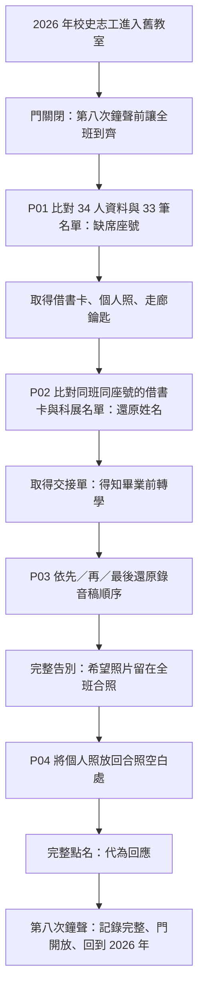

# 不存在的第八節課

版本：小安初稿 v0.1｜2026-10-29
狀態：主題已由使用者選定；人物、謎題、介面與資料欄位供團隊審閱，尚未實作遊戲。
負責：小安（故事、使用者故事、解謎流程、內容資料與劇情測試）。

## 1. 一句話故事

你在舊校舍整理校史，放學後卻困在不斷響起點名廣播的教室。要離開，你必須在「第八次鐘聲」到來時，讓一位被畢業紀錄漏掉的同學重新成為班級的一員。

## 2. 體驗目標與範圍

- 類型：2D 固定場景、點擊探索、道具與證據解謎。
- 調性：微懸疑、懷舊、帶溫暖收尾；初稿不使用血腥、追逐或突然驚嚇。
- 玩家：沒有密室經驗也能透過文字、觀察與提示推進的人。
- 建議遊玩長度：15–20 分鐘，屬於設計目標，須實際試玩確認。
- 首版範圍：3 個場景、3 道主要謎題與 1 個收尾互動、單一完整結局。
- 所有解答的依據都放在遊戲內，不需要網路搜尋、校史知識或聽力辨識。
- 鐘聲是敘事進度，不是真實倒數；停下來閱讀、輸入錯誤或切換場景都不會讓玩家輸掉。
- 首版採固定答案，不做隨機密碼、多周目、分歧結局或即時多人。
- 最終作品須能以純前端 HTML、CSS、JavaScript 靜態展示；本稿不替小星決定套件或技術架構。

## 3. 人物與設定

| 人物 | 身分與作用 |
| --- | --- |
| 玩家 | 2026 年協助整理舊校舍的校史志工；並非必須失憶或認識當年的學生。 |
| 林予安 | 1998 年三年二班 17 號，畢業前轉學。她留下個人照及告別廣播稿，希望被放進班級紀念冊。 |
| 許老師 | 當年的導師；以舊點名錄音出現，停留在沒有收到回應的 17 號。 |

學校、班級與人物均為虛構。故事不把轉學等同死亡，也不暗示轉學生應被排除在班級之外。

### 作者知道的真相

班上原有 34 人，林予安在畢業前轉學，最後的畢業名冊只有 33 人。她留給同學的個人照與告別稿沒有被放進紀念冊，校史整理時又只抄錄畢業名冊，於是她在這份「班級記憶」中缺席。

舊校舍這一晚重現的是未完成的班級記憶，不是世界上所有關於她的資料都被消除。因此借書卡、轉學資料及個人照仍可以作為證據。

玩家最初以為必須讓 34 個人實際回到教室，後來理解「到齊」是讓每位同學都被記錄與承認。林予安仍是當年的一員，不必撤銷轉學或召回她本人。

## 4. 故事節拍

### 開場：有一節不在課表上的課

玩家進入舊教室取回校史資料，門在身後合上。走廊重複出現「三年二班」門牌。

黑板寫著：「請在第八次鐘聲，讓全班到齊。」

舊廣播響起：「三年二班，開始點名……十六號……」錄音在下一個名字前停住。班級合照有一個明顯留下的空白位置。

第一階段只提出異常與目標，不直接告知林予安的姓名或轉學真相。

### 第一幕：少掉的座號

班級資料寫著原有 34 人，現存名單卻只有 33 筆。名單按座號排列，16 與 18 之間沒有 17。

玩家將缺少的兩位數座號輸入「待歸還物品抽屜」，取得 17 號借書卡、個人照和通往走廊資料區的鑰匙。

獲得的新理解：缺席的是一個有座號的人，合照空白不是普通污損。

### 第二幕：把名字拼回來

借書卡的姓名欄留下「林□安」，走廊科展名單則留下「□予□」，兩者都明確標示三年二班 17 號。玩家交叉比對，還原姓名「林予安」。

姓名補回紀念名冊後，廣播室資料櫃開放，出現她的轉學交接單。單上說明她已在畢業前轉出，並提到先還書、再交告別廣播稿、最後辦轉學離校的順序。

獲得的新理解：她不是幽靈，也不是失蹤案件；她曾主動留下想被記得的話。

### 第三幕：最後一天並沒有告別

廣播室留有三段標籤清楚但順序散落的錄音稿：「還書」「廣播」「轉學」。玩家根據交接單還原順序，再播放完整文字與錄音。

告別稿：「我會去新的學校，但請不要把我的位置擦掉。如果合照來不及，這張照片可以替我留下來嗎？」

獲得的新理解：真正沒有完成的是告別與紀念，不是把學生帶回教室。

### 結尾：最後一聲「到」

玩家回到教室，將先前取得的個人照放入合照空白處。最後點名這次完整唸出「十七號，林予安」。

玩家以「代為回應點名」完成最後互動，畫面顯示：「到。轉學，也是我們班的一員。」

第八次鐘聲響起，教室回到 2026 年，門打開。校史紀念頁保留 34 位曾經在班上的同學，並註記林予安畢業前轉學；不把它冒充當年的正式畢業證書或畢業名冊。

最後文字：「離開教室的人，不該因此被擦掉。」

## 5. 場景與探索範圍

| ID | 場景 | 主要互動 | 敘事用途 |
| --- | --- | --- | --- |
| S01 | 舊教室 | 黑板、33 人名單、班級資料、物品抽屜、合照、廣播按鈕 | 建立異常、開始與結束點名 |
| S02 | 走廊資料區 | 科展名單、紀念名冊、廣播室資料櫃 | 用第二份證據還原姓名 |
| S03 | 廣播室 | 交接單、三段錄音稿、播放設備 | 還原最後一天與未完成的告別 |

S01 起始可探索；P01 完成後可進 S02；P02 完成後可進 S03。開放後可返回舊場景閱讀證據，不能因換房間失去必需物品。這些是交接用玩法提案，具體介面與狀態實作由小星補入 VERIFY 的機關段。

## 6. 謎題設計表（含作者解答）

### P01：缺席的座號

- 前置：開始遊戲。
- 證據：E01「班級原有 34 人」；E02 列出 1–34 的座號，唯獨沒有 17，合計 33 筆。
- 題面：「待歸還物品：請輸入缺少的兩位數座號。」
- 答案：`17`；UI 可用兩格數字輸入。前後空白處理交由小星確定，不接受其他座號。
- 結果：取得 I01 借書卡、I02 個人照與 I03 走廊資料區鑰匙，開放 S02。
- 故事收穫：找到被漏掉的學生位置。
- 錯誤回饋：「抽屜沒有打開。請再比較班級人數與座號。」不清空進度；空白、格式錯誤的提示由小星補充。
- 提示 1：「全班原本的人數，和留下的名單不一樣。」
- 提示 2：「先確認名單是否按照座號連續排列。」
- 提示 3：「看看十六號與十八號之間，原本應該還有哪一筆。」

### P02：有座號，沒有名字

- 前置：P01 完成，S02 已開放。
- 證據：E03 借書卡「三年二班／17 號／林□安」；E04 科展名單「三年二班／17 號／□予□」。
- 題面：「請為紀念名冊中的十七號補回姓名。」
- 答案：`林予安`。
- 推理：用相同班級與座號確認兩份資料指向同一人；姓名三個位置各有足夠字元，不能只憑猜測補字。
- 結果：名冊顯示姓名；取得 I04 轉學交接單，開放 S03。
- 故事收穫：學生有完整身分，她是轉學而非死亡或失蹤。
- 錯誤回饋：「請確認兩份資料上的班級與座號，再比對姓名。」
- 提示 1：「同一個人可能在不同活動中留下紀錄。」
- 提示 2：「找出和借書卡相同班級、相同座號的那一列。」
- 提示 3：「把兩份姓名欄依照第一、第二、第三個字對齊。」

### P03：被打亂的告別

- 前置：P02 完成；玩家可讀取 E05 轉學交接單。
- E05 原文：「先把借的書還了，再把告別廣播稿交給廣播室，最後辦好轉學離校。」
- 題面：「依交接單，將三段錄音稿排回當天的順序。」
- 待排序項：`return_book`（還書）、`read_farewell`（廣播）、`transfer_school`（轉學）。
- 答案：`return_book → read_farewell → transfer_school`。
- 結果：取得 I05 完整告別稿；確認個人照應放回合照。
- 故事收穫：她曾請求留在大家的記憶裡，但告別沒有完成。
- 錯誤回饋：「事件都找到了，但順序還不符合交接單。」
- 提示 1：「日期相同，不代表事情同時發生。」
- 提示 2：「交接單寫了三件事，也留下它們的先後關係。」
- 提示 3：「留意『先』『再』『最後』，不用靠聲音猜順序。」
- 三段均提供文字稿；聲音關閉時仍可完成。不用拖曳也應可排序，操作方式由小星設計。

### P04：最後一次點名

- 前置：P03 完成；玩家持有 I02 個人照與 I05 完整告別稿。
- 題面：「她想留下的位置，在哪裡？」
- 依據：E06 告別稿提出個人照可補進合照；E07 合照留有一格明顯空白。
- 正確互動順序：`restore_group_photo → answer_roll_call`（先放回照片，再代為回應）。
- 結果：完整點名、完成結局 END01、出口開放。
- 放錯位置回饋：「這張照片需要一個能與全班留在一起的位置。」物品保留。
- 提前回應回饋：「點名還停在空白處。先讓她在班級紀錄裡有一個位置。」
- 提示 1：「『到齊』不一定是把每個人都帶回房間。」
- 提示 2：「再讀一次她留在告別稿裡的請求。」
- 提示 3：「檢查背包中的個人照，以及教室中一直沒有補上的空白。」

## 7. 使用者故事

| ID | 作為玩家，我希望…… | 對應驗收 |
| --- | --- | --- |
| US01 | 開始時知道自己為何在這裡、要完成什麼，而不是只看到鎖住的門。 | V-A01 |
| US02 | 從遊戲提供的名單與人數推導缺席座號。 | V-A02 |
| US03 | 透過兩份指向同一人的資料還原姓名。 | V-A03 |
| US04 | 還原事件後明白人物處境，而不只是得到下一個密碼。 | V-A04、V-A05 |
| US05 | 不會時能逐級取得方向，不必立刻被告知答案。 | V-A06 |
| US06 | 依自己的閱讀速度探索，輸入錯誤不會使劇情無法完成。 | V-A07、V-A08 |
| US07 | 關閉音效仍能讀懂廣播並完成謎題。 | V-A09 |
| US08 | 最終互動能回應人物願望，並清楚知道已逃出。 | V-A10 |

## 8. 解謎流程圖

錯誤答案與看提示只回到當前謎題；不通往死亡、壞結局或不可逆消耗。此流程沒有需要先完成自己才能取得線索的循環依賴。

## 9. 鐘聲與內容揭露

| 鐘聲 | 一次性觸發點 | 可揭露內容 |
| --- | --- | --- |
| 1 | 開場 | 目標與缺席異常 |
| 2 | P01 完成 | 17 號與物品 |
| 3 | P02 完成 | 姓名、轉學紀錄 |
| 4 | P03 完成 | 完整告別 |
| 5 | P03 後第一次回到教室 | 黑板改為「把她的位置留下」 |
| 6 | 個人照放回合照 | 合照復原 |
| 7 | 復原後自動播放最後點名 | 只唸完整姓名，等待玩家回應 |
| 8 | 代為回應點名 | 結局與出口 |

同一事件只計一次；重看場景、重播已讀文本、錯誤輸入和提示都不額外計鐘聲。小星可依實作調整演出節奏，但不能將第八次鐘聲改成玩家未被告知的即時失敗條件。

第七聲的點名與第八聲的回應分開；不得在玩家選擇前就播放「到」或提前開門。實際事件串接由小星實作，小雪做整合驗證。

## 10. 內容交接與驗證

- `content/story.json`：本稿的結構化資料提案，包含場景、證據、道具、謎題、提示、鐘聲與結局。
- ID 提案：S 場景、E 證據、I 道具、P 謎題、END 結局；小星確認欄位前不視為已定案的程式介面。
- `VERIFY.md`：小安只寫「謎題與劇情」段；機關段留小星補充。
- `TESTS.md`：小安寫劇情測試案例；機關與整合段留負責人填寫。
- `tests/story.test.mjs`：小安使用 Node 內建測試檢查內容資料，不新增第三方依賴，不代表團隊已定案網頁或整合測試框架。
- `assets/ASSET_PLAN.md`：美術、聲音與文字替代需求；實際圖音尚未製作。
- `PLAYTEST.md`：待實玩後記錄，不把內容資料檢核冒充玩家試玩。

## 11. 需小星／小雪共同確認的事項

1. 場景、道具和謎題的資料欄位是否可直接採用；如需變更，三方同步 ID 與引用。
2. 輸入姓名、排序錄音稿、道具放置的操作方式；小安只定義玩家應能表達的答案。
3. 提示呈現、存檔、重新開始及一次性鐘聲的狀態規則，由小星補驗收，小雪補整合測試。
4. 先確認三場景與四階段能在期中時程內完成，再考慮擴充內容。

本初稿未包含 game/ 實作、部署或他人負責的測試；內容檢核無法證明遊戲已可玩。
